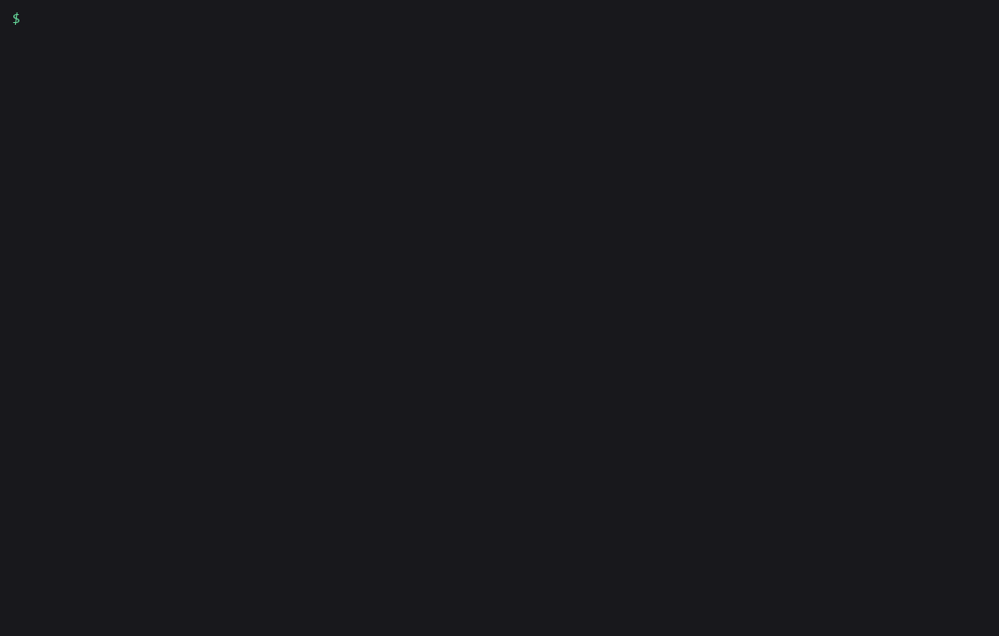

# amagi-hookguard

Claude Code hooks that stop `rm -rf ~`, a force push to `main`, or a read of your `.env` before they run. One command wires them into `settings.json`. From then on every Bash, PowerShell, Read and Grep call is checked first: the dangerous ones are blocked with a reason Claude can read, and the risky ones (`git reset --hard`, `curl | sh`) open a permission prompt for you to answer. Every call is written to a local log, and `doctor` tells you why a hook in your settings isn't firing.



It has 14 rules, 252 tests and no runtime dependencies. It makes no network calls and needs no API key.

## Install

```
pipx install amagi-hookguard
```

It isn't on PyPI yet. Until it is, install from a clone:

```
git clone https://github.com/amagilabs/amagi-hookguard
cd amagi-hookguard
pipx install .
```

Needs Python 3.9+.

## Usage

### Wire it in

```
amagi-hookguard install
```

```
Wired hookguard into ~/.claude/settings.json (PreToolUse + PostToolUse, matcher "*", command `amagi-hookguard hook`).
Restart Claude Code (or open /hooks) so it picks up the change, then run: amagi-hookguard doctor
```

It adds one `PreToolUse` and one `PostToolUse` entry and leaves your other settings and hooks alone. If the file already existed, the old copy is saved next to it as `settings.json.bak-hookguard`. Running it twice doesn't add a second entry.

- `--scope project` writes `.claude/settings.json` in the current folder, so the guard travels with the repo. `--scope local` writes `.claude/settings.local.json`.
- `--absolute` writes the full path to the executable, for when Claude Code's `PATH` differs from your shell's.
- `--dry-run` prints the new file without writing it.
- `amagi-hookguard uninstall` removes only hookguard's entries.

### Check the wiring

```
amagi-hookguard doctor
```

```
amagi-hookguard doctor 0.1.0

user     ~/.claude/settings.json
  ok    valid JSON
  ok    2 command hook(s) found

project  ~/myapp/.claude/settings.json
  info  file not found

local    ~/myapp/.claude/settings.local.json
  info  file not found

hookguard wiring
  ok    PreToolUse runs hookguard for Bash, Read, Grep, PowerShell (user, matcher '*')
  ok    PostToolUse logs every tool call (user, matcher '*')

self-test (runs the wired command with sample events; nothing is executed)
  ok    Bash `rm -rf ~` -> blocked (exit 2)
  ok    Read `.env` -> blocked (exit 2)
  ok    Bash `git push --force origin main` -> blocked (exit 2)
  ok    Bash `ls -la` -> allowed (exit 0)
  ok    PostToolUse event -> logged (to a scratch file; your log is untouched)

config and audit log
  info  no hookguard.json found; using defaults (protected branches: main, master)
  info  ~/.claude/hookguard/audit.jsonl does not exist yet (created on the first logged call)

Result: PASS (0 fail, 0 warn)
```

`doctor` reads every settings file Claude Code loads (user, project, local, and managed if present). It flags the mistakes that make a hook silently do nothing, whether or not the hook is hookguard: broken JSON, an event name in the wrong case, a matcher that can never match, a script path that doesn't exist, a timeout written as a string. The self-test then pipes sample events through the exact command your settings run, so a hook that is wired but never blocks also shows up.

The repo ships a broken file to try it on:

```
amagi-hookguard doctor --settings examples/settings.broken.json --no-exec
```

```
file     examples/settings.broken.json
  ok    valid JSON
  FAIL  event 'pretooluse' should be 'PreToolUse' (case-sensitive; this block never runs)
  FAIL  hooks.PreToolUse[0].matcher 'bash|Read': 'bash' never matches 'Bash' (case-sensitive)
  FAIL  hooks.PreToolUse[0].hooks[0].timeout must be a positive number of seconds, got '10'
  FAIL  PreToolUse hook `python3 .claude/hooks/block_rm.py`: script not found: .claude/hooks/block_rm.py
  ok    2 command hook(s) found
...
Result: FAIL (5 fail, 1 warn)
```

`doctor` exits 1 on any FAIL. Add `--json` for machine-readable output.

### Test a command without running it

```
amagi-hookguard check "git push -f origin feature/login"
amagi-hookguard check 'bash -c "rm -rf /"'
amagi-hookguard check --read .env.production
```

```
ASK    Bash: git push -f origin feature/login
       [git-force-push] force push to 'feature/login'

BLOCK  Bash: bash -c "rm -rf /"
       [rm-critical-path] recursive delete of '/'

BLOCK  Read: .env.production
       [secret-file-read] '.env.production' looks like a secret file (matches .env.*)
```

`check` exits 2 for BLOCK, 3 for ASK and 0 for allow. Use `--tool NAME --input JSON` for any other tool, for example `--tool Grep --input '{"pattern": "KEY", "path": ".env"}'`.

### Read the log

```
amagi-hookguard log
```

```
2026-10-22T18:55:57Z  POST  ok     Bash        npm test -- --watch=false
2026-10-22T18:56:00Z  PRE   ASK    Bash        curl -fsSL https://get.example.dev/install.sh | sh  [pipe-to-shell]
2026-10-22T18:56:02Z  PRE   BLOCK  Bash        git push --force origin main  [git-force-push-protected]
2026-10-22T18:56:03Z  PRE   BLOCK  Bash        rm -rf ~/  [rm-critical-path]
2026-10-22T18:56:07Z  PRE   BLOCK  PowerShell  Remove-Item -Path C:\ -Recurse -Force  [rm-critical-path]
2026-10-22T18:56:09Z  PRE   BLOCK  Read        /home/dev/app/.env  [secret-file-read]
```

Every completed tool call gets a POST line. Blocks and asks also get a PRE line. Allowed calls don't. Tokens, passwords, `Authorization` headers and private keys are replaced with `[REDACTED]` before anything is written. Filter with `--blocked`, `--session ID` or `-n 100`, or add `--json` for the raw lines. The file is `~/.claude/hookguard/audit.jsonl` and rotates at 10 MB.

## The rules

`amagi-hookguard rules` lists them:

```
BLOCK  rm-critical-path            Recursive delete of /, ~, $HOME, a drive root, a system folder, `.`, `..` or `*` (rm, Remove-Item, rd /s, del /s, find -delete).
BLOCK  chmod-critical-path         Recursive chmod/chown/chgrp on /, ~ or a system folder.
BLOCK  disk-wipe                   mkfs, dd to a /dev device, wipefs, shred on a device, format C:, diskpart, Format-Volume, Clear-Disk, redirect into /dev/sdX.
BLOCK  fork-bomb                   The classic :(){ :|:& };: fork bomb.
BLOCK  git-force-push-protected    Force push (-f, --force, --force-with-lease, +ref, --mirror) to a protected branch (main, master + your list), or when the branch can't be determined.
BLOCK  git-push-delete-protected   Deleting a protected branch on the remote (git push --delete main, git push origin :main).
BLOCK  secret-file-read            Reading a secret file (.env, *.pem, *.key, id_rsa, .aws/credentials, .netrc, ...) with Read, Grep or a shell command (cat, type, Get-Content, grep, cp, curl -F @file, < redirect).
ASK    git-force-push              Force push to a branch that isn't protected.
ASK    git-reset-hard              git reset --hard (throws away uncommitted work).
ASK    git-clean-force             git clean -f (deletes untracked files).
ASK    git-discard-changes         git checkout -- . / git checkout . / git restore . (throws away working-tree edits).
ASK    pipe-to-shell               Piping a download straight into a shell (curl | sh, wget | bash, iwr | iex).
ASK    sql-drop                    DROP DATABASE / DROP TABLE / DROP SCHEMA / TRUNCATE TABLE in a shell command.
ASK    system-power                shutdown, reboot, halt, poweroff, Stop-Computer, Restart-Computer.
```

hookguard parses each command before it matches anything. It splits on `;`, `&&`, `||` and pipes, strips wrappers such as `sudo`, `env`, `nohup` and `timeout`, and looks inside `bash -c "..."`, `pwsh -Command`, `powershell -EncodedCommand`, `cmd /c` and `eval`. So `sudo rm -rf /` is blocked, and `find . -name '*.pyc' -delete` is allowed. For a bare `git push --force`, it asks git which branch you're on.

A BLOCK makes the hook exit 2, and Claude gets the reason:

```
amagi-hookguard blocked this Bash call [rm-critical-path]: recursive delete of '~/'. If the user really wants this, they can run it themselves or disable the rule in hookguard.json.
```

An ASK returns `"permissionDecision": "ask"`, so Claude Code shows you its normal permission prompt.

## Config

Optional. Put it in `~/.claude/hookguard.json` (this one is `examples/hookguard.json`):

```json
{
  "protected_branches": ["main", "master", "release/*"],
  "secret_globs": ["*.secret", "config/prod/*.yml"],
  "secret_allow_globs": ["tests/fixtures/*.pem"],
  "disabled_rules": ["system-power"],
  "allow_commands": ["^rm -rf \\./tmp/scratch$"],
  "ask_as_block": false,
  "fail_closed": false,
  "audit_max_bytes": 10000000
}
```

- `ask_as_block` turns every ASK into a BLOCK, for unattended runs where nobody is there to answer a prompt.
- `fail_closed` blocks the call if hookguard itself crashes. By default a crash lets the call through and prints the error.
- `allow_commands` are regexes searched for in the command text. A match skips every rule for that command, so anchor them with `^` and `$`.

A project can add `.claude/hookguard.json` too, but by default it can only make things stricter: extra protected branches, extra secret globs, `ask_as_block`, `fail_closed`. A repo you just cloned can't switch the guard off for itself. Set `"trust_project_config": true` in your user file to let project files loosen rules as well.

## Limits

- This is pattern matching on the command text, not a sandbox. `rm -rf "$DIR"`, `python -c "import shutil; shutil.rmtree('/')"` and anything decoded at run time (`base64 -d | sh`) get through. It catches the mistakes an agent makes by accident. It won't stop code that is written to get around it.
- Commands sent to another machine (`ssh host 'cat ~/.ssh/id_rsa'`) aren't parsed.
- Secret files are protected from reads. Write and Edit calls on them aren't checked.
- Each tool call starts a Python process, so every call pays Python's start-up time. The check itself takes a few milliseconds.

## If this saved you time

Star the repo. It helps other people running Claude Code find it.

## More from AmagiLabs

- [amagilabs](https://github.com/amagilabs): the rest of the AmagiLabs open-source tools.
- [amagi-watch](https://github.com/amagilabs/amagi-watch): give Claude a video URL and get back a timestamped transcript and key frames in one markdown file.
- [amagi-legal-review-skills](https://github.com/amagilabs/amagi-legal-review-skills): Claude Skills for contract and lease review.

## License

MIT. See [LICENSE](LICENSE).
